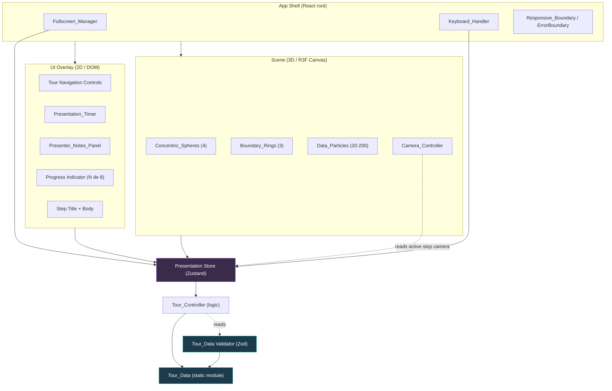

# Design Document

## Overview

O **Clean Architecture 3D Visualizer** é uma SPA 100% estática, sem backend, construída com **Vite + React + TypeScript + Tailwind CSS** e renderização 3D via **Three.js + React Three Fiber (R3F) + @react-three/drei**. O objetivo é apoiar uma apresentação de 30 minutos no IFSP, oferecendo uma "cebola 3D com corte de 90 graus" das quatro camadas da Clean Architecture, com um tour guiado de 8 passos do caso de uso "CriarPedido".

O princípio arquitetural central do projeto é o mesmo que ele ensina: **a Regra da Dependência**. A aplicação é organizada em três domínios fortemente desacoplados que apontam para dentro, em direção aos dados:

- **Scene (3D)** — tudo que é renderizado no `<Canvas>` do R3F (esferas, anéis, partículas, câmera).
- **UI Overlay (2D)** — a interface HTML/DOM sobreposta (controles, timer, notas, indicadores).
- **Tour Data (estático)** — o conteúdo do tour, puro e sem dependências de React ou Three.js.

A comunicação entre a Scene e a UI ocorre exclusivamente por meio de um **estado de apresentação compartilhado** (um store leve). Nem a Scene importa a UI, nem a UI importa a Scene; ambas leem/escrevem no store. O módulo Tour_Data não importa nada dos outros dois — ele é o "núcleo" (Entities/Use Cases) da própria aplicação, uma demonstração viva do conceito apresentado.

Esta decisão de design garante que o requisito 5 (dados desacoplados) seja estrutural, não apenas convencional: alterar o texto de um passo nunca toca em código de cena ou de UI.

### Principais decisões de design

| Decisão | Racional |
|---|---|
| Store compartilhado (Zustand) em vez de Context+props | R3F roda em uma árvore de reconciliação separada (`react-three-fiber`); um store externo evita "prop drilling" entre a árvore DOM e a árvore do Canvas e não força re-render de toda a cena a cada tick do timer. |
| Tour_Data como módulo TS puro validado em runtime | Cumpre o requisito 5 (desacoplamento) e o requisito 5.3/5.4 (validação com rejeição e mensagem de erro). Validação com **Zod** para bordas de campo. |
| Transições de câmera imperativas via `useFrame` | Lerp por quadro com easing é mais previsível e cancelável (req. 3.7) do que animações declarativas. |
| Corte de 90° via `THREE.SphereGeometry` com `thetaLength`/`phiLength` parciais | Remove um quadrante geometricamente, sem custo de clipping planes por material. |
| Vite `base` configurável | Cumpre o requisito 10.4 (deploy em subcaminho no GitHub Pages) sem alterar código. |

### Escopo de pesquisa e achados

Pontos que exigiram pesquisa técnica e como informam o design:

- **Corte de seção de 90°**: `THREE.SphereGeometry(radius, widthSegments, heightSegments, phiStart, phiLength, thetaStart, thetaLength)` permite gerar apenas 3/4 da esfera usando `phiLength = 1.5·π` (270°), removendo um quadrante e expondo a superfície interior. Como as esferas ficam abertas, usa-se `material.side = THREE.DoubleSide` para renderizar a face interna. ([Three.js SphereGeometry docs](https://threejs.org/docs/#api/en/geometries/SphereGeometry))
- **`prefers-reduced-motion`**: detectável via `window.matchMedia('(prefers-reduced-motion: reduce)')`, com listener para mudanças em runtime. Informa o requisito 2.3. ([MDN prefers-reduced-motion](https://developer.mozilla.org/en-US/docs/Web/CSS/@media/prefers-reduced-motion))
- **Fullscreen API**: `element.requestFullscreen()` retorna uma `Promise` que **rejeita** quando negada — captura obrigatória para o requisito 9.3. O evento `fullscreenchange` e a tecla Esc (tratada pelo navegador) cobrem o requisito 9.5. ([MDN Fullscreen API](https://developer.mozilla.org/en-US/docs/Web/API/Fullscreen_API))
- **Fallback de WebGL**: R3F expõe `onCreated`/`onError` no `<Canvas>`, e é possível checar suporte com um `WebGLRenderingContext` de teste antes de montar o Canvas, cobrindo o requisito 1.6. ([R3F Canvas docs](https://r3f.docs.pmnd.rs/api/canvas))

*Conteúdo reformulado para conformidade com restrições de licenciamento.*

## Architecture

A aplicação segue uma arquitetura de três domínios desacoplados coordenados por um store de apresentação. As dependências apontam para dentro (em direção ao Tour_Data), espelhando a Dependency_Rule.



### Fluxo de dependências (regra de importação)

- `tour-data/*` **não importa** de `scene/*` nem de `ui/*` nem de React.
- `scene/*` e `ui/*` **podem importar** de `state/*` (store) e de `tour-data/*` (tipos e dados validados).
- `scene/*` **não importa** de `ui/*` e vice-versa.
- O `state/*` (store + Tour_Controller) importa apenas de `tour-data/*`.

Essa direção de importação é a materialização concreta do requisito 5.1 e pode ser verificada estaticamente (ex.: regra `import/no-restricted-paths` no ESLint).

### Diretório desacoplado

```
clean-architecture-3d-visualizer/
├── index.html
├── vite.config.ts            # base configurável (req. 10.4)
├── tsconfig.json
├── tailwind.config.ts
├── package.json
└── src/
    ├── main.tsx              # bootstrap React
    ├── App.tsx               # App Shell: compõe Scene + UI, ErrorBoundary
    │
    ├── tour-data/            # ── DOMÍNIO 1: DADOS (núcleo, sem deps) ──
    │   ├── types.ts          # Tour_Step, Layer, CameraConfig, Vec3
    │   ├── tour-data.ts      # os 8 Tour_Steps do "CriarPedido"
    │   ├── palette.ts        # paleta de cores fixa por Layer
    │   └── validate.ts       # validação Zod + regras de ordem/Layer
    │
    ├── state/                # ── COORDENAÇÃO ──
    │   ├── presentation-store.ts   # Zustand: step ativo, timer, flags UI
    │   ├── tour-controller.ts      # máquina de estados do tour
    │   └── selectors.ts
    │
    ├── scene/                # ── DOMÍNIO 2: 3D (não importa ui/) ──
    │   ├── SceneCanvas.tsx         # <Canvas> R3F + fallback WebGL
    │   ├── ConcentricSpheres.tsx   # 4 esferas, corte 90°, materiais PBR
    │   ├── BoundaryRings.tsx       # 3 anéis luminosos
    │   ├── DataParticles.tsx       # sistema de partículas
    │   ├── CameraController.tsx    # lerp + easing + gating manual
    │   └── geometry.ts             # helpers de geometria (raios, corte)
    │
    ├── ui/                   # ── DOMÍNIO 3: 2D (não importa scene/) ──
    │   ├── Overlay.tsx             # layout responsivo do overlay
    │   ├── TourControls.tsx        # avançar/retroceder + indicador
    │   ├── PresentationTimer.tsx   # mm:ss + faixas de cor
    │   ├── PresenterNotesPanel.tsx # painel de notas
    │   └── WebGLFallback.tsx       # mensagem de navegador incompatível
    │
    └── platform/             # ── ADAPTADORES DE PLATAFORMA ──
        ├── useKeyboardShortcuts.ts # atalhos + gating em inputs de texto
        ├── useFullscreen.ts        # Fullscreen API + rejeição
        ├── useReducedMotion.ts     # prefers-reduced-motion
        └── useViewportBreakpoint.ts# breakpoints responsivos + resize
```

## Components and Interfaces

### Presentation Store (`state/presentation-store.ts`)

Fonte única de verdade compartilhada entre Scene e UI. Não contém lógica de negócio complexa (delegada ao Tour_Controller); é um contêiner de estado observável.

```typescript
interface TransitionState {
  isTransitioning: boolean;   // true durante lerp de câmera / troca de passo
}

interface PresentationState {
  // Tour
  activeStepOrder: number;          // 1..N (ordem do Tour_Step ativo)
  transition: TransitionState;
  // Timer
  timer: TimerState;                // ver Data Models
  // UI flags
  notesVisible: boolean;            // inicia false (req. 8.6)
  isFullscreen: boolean;
  // Erros de carregamento
  dataError: TourDataError | null;  // null = dados válidos
  webglSupported: boolean;

  // Ações (delegam ao Tour_Controller / timers)
  next(): void;
  prev(): void;
  resetCamera(): void;
  toggleNotes(): void;
  setFullscreen(on: boolean): void;
}
```

### Tour_Controller (`state/tour-controller.ts`)

Máquina de estados pura sobre a ordem do passo ativo. Isola as invariantes do requisito 4. Não conhece React nem Three.js.

```typescript
interface TourController {
  /** Total de passos válidos carregados (1..50). */
  readonly stepCount: number;
  /** Ordem do passo ativo, sempre em [1, stepCount]. */
  readonly activeOrder: number;

  /**
   * Avança um passo. Se já no último, mantém (req. 4.5).
   * Se uma transição está em andamento, ignora (req. 4.10).
   */
  next(isTransitioning: boolean): number;

  /** Retrocede um passo. Clamp no primeiro (req. 4.6). Ignora em transição (req. 4.10). */
  prev(isTransitioning: boolean): number;

  /** Retorna o Tour_Step ativo resolvido a partir do Tour_Data. */
  getActiveStep(): TourStep;
}
```

A função de transição pura pode ser expressa como `clamp`:

```typescript
function computeNext(active: number, count: number): number {
  return Math.min(active + 1, count);
}
function computePrev(active: number): number {
  return Math.max(active - 1, 1);
}
```

### Scene_Renderer (`scene/`)

- **`SceneCanvas.tsx`**: verifica suporte a WebGL antes de montar; em falha, renderiza `WebGLFallback` e não monta nenhuma esfera (req. 1.6). Suspende o `frameloop` quando o viewport tem dimensão ≤ 0 (req. 11.5) e retoma quando > 0.
- **`ConcentricSpheres.tsx`**: gera 4 esferas via `geometry.ts`, com raios estritamente crescentes, corte de 90° (`phiLength = 1.5π`), `DoubleSide`, material PBR (`meshStandardMaterial`) e cor da `palette`. Aplica destaque (emissive/opacity) apenas à Layer em foco do passo ativo (req. 4.8).
- **`BoundaryRings.tsx`**: 3 anéis nas fronteiras entre esferas adjacentes.
- **`DataParticles.tsx`**: instância entre 20 e 200 partículas via `InstancedMesh`; recicla ao atingir a fronteira (req. 2.5); orienta o vetor conforme o passo (req. 2.2); congela em `prefers-reduced-motion` (req. 2.3); clampa a contagem em 200 (req. 2.4).
- **`CameraController.tsx`**: interpola posição/alvo por `useFrame` com easing (req. 3.1), duração configurável 0,3–2,0 s (padrão 1,0 s) (req. 3.2); habilita/desabilita `OrbitControls` conforme `isTransitioning` (req. 3.4/3.5); reset cancela transição em curso (req. 3.7).

```typescript
interface CameraControllerProps {
  target: CameraConfig | null;   // null => sem transição (req. 3.6)
  durationSeconds: number;       // 0.3..2.0, default 1.0
  onTransitionEnd(): void;
}
```

### UI_Overlay (`ui/`)

- **`Overlay.tsx`**: aplica os breakpoints do requisito 11 (≥1024, 640–1024, <640) usando `useViewportBreakpoint`.
- **`TourControls.tsx`**: botões avançar/retroceber + título/texto do passo + indicador "N de 8".
- **`PresentationTimer.tsx`**: exibe mm:ss e aplica faixa de cor (verde/amarelo/vermelho) via função pura `timerColorBand`.
- **`PresenterNotesPanel.tsx`**: visível/oculto (req. 8), estado vazio, truncamento em 5.000 caracteres.

### Platform adapters (`platform/`)

```typescript
// useKeyboardShortcuts: ignora teclas quando foco em campo de texto editável (req. 7.9)
function isEditableTarget(el: EventTarget | null): boolean;

// useFullscreen: retorna estado + toggle que trata rejeição (req. 9.3)
interface FullscreenApi {
  isFullscreen: boolean;
  toggle(): Promise<{ ok: boolean; error?: unknown }>;
}
```

## Data Models

### Tipos base

```typescript
/** Vetor 3D imutável. */
type Vec3 = readonly [x: number, y: number, z: number];

/** Identificadores válidos de Layer (fechado). */
type Layer =
  | 'Entities'
  | 'Use_Cases'
  | 'Interface_Adapters'
  | 'Frameworks_And_Drivers';

const LAYER_ORDER: readonly Layer[] = [
  'Entities',              // raio menor (interna)
  'Use_Cases',
  'Interface_Adapters',
  'Frameworks_And_Drivers' // raio maior (externa)
] as const;
```

### Paleta de cores (`tour-data/palette.ts`)

Exatamente uma cor por Layer, mutuamente distintas (req. 1.3). Cores em formato hex; faixas de cor do timer separadas.

```typescript
const LAYER_PALETTE: Readonly<Record<Layer, string>> = {
  Entities:               '#F2C94C', // amarelo-ouro (núcleo)
  Use_Cases:              '#EB5757', // vermelho-coral
  Interface_Adapters:     '#2D9CDB', // azul
  Frameworks_And_Drivers: '#27AE60'  // verde
};

const TIMER_BANDS = {
  green:  { fromSec: 0,       toSec: 20 * 60, color: '#27AE60' },
  yellow: { fromSec: 20 * 60, toSec: 27 * 60, color: '#F2C94C' },
  red:    { fromSec: 27 * 60, toSec: Infinity, color: '#EB5757' }
} as const;
```

### CameraConfig

```typescript
interface CameraConfig {
  position: Vec3;  // posição da câmera
  target: Vec3;    // ponto de mira (lookAt)
}
```

### Tour_Step e Tour_Data (`tour-data/types.ts`, `tour-data.ts`)

```typescript
interface TourStep {
  order: number;        // inteiro único 1..50, sequencial sem lacunas (req. 5.2)
  title: string;        // 1..80 caracteres
  body: string;         // 1..1000 caracteres
  focusLayer: Layer;    // referência a uma Layer existente (req. 5.4)
  camera: CameraConfig; // posição + alvo
  notes: string;        // 0..2000 caracteres
}

type TourData = readonly TourStep[];  // 1..50 registros (req. 5.2)
```

Os 8 passos do "CriarPedido" mapeiam para as Layers assim:

| order | title (resumo) | focusLayer |
|---|---|---|
| 1 | Visão geral e a Regra da Dependência | Frameworks_And_Drivers (visão geral) |
| 2 | Frameworks & Drivers | Frameworks_And_Drivers |
| 3 | Interface Adapters | Interface_Adapters |
| 4 | Fronteira e Inversão de Dependência | Interface_Adapters |
| 5 | Use Cases | Use_Cases |
| 6 | Entities | Entities |
| 7 | Adaptadores de retorno | Interface_Adapters |
| 8 | Síntese — "Detalhes são Detalhes" | Entities |

### TimerState

```typescript
type TimerStatus = 'idle' | 'running' | 'paused';

interface TimerState {
  status: TimerStatus;
  elapsedSec: number;   // >= 0, não limitado a 30:00 (req. 6.8)
}
```

### Modelo de validação do Tour_Data (`tour-data/validate.ts`)

```typescript
interface TourDataError {
  stepOrder: number | null;   // qual Tour_Step (null se erro global)
  field: string;              // qual campo inválido
  message: string;            // mensagem exibível ao usuário
}

/**
 * Valida os limites de campo (Zod), a sequência de order IDs
 * (1..N sem lacunas nem duplicatas) e as referências de Layer.
 * Retorna a lista de erros (vazia = válido).
 */
function validateTourData(data: unknown): TourDataError[];
```

Regras de validação (req. 5.2/5.3/5.4):

- `order`: inteiro, `1..50`, único, e o conjunto ordenado deve ser exatamente `1..N` (sequencial, sem lacunas).
- `title`: string de comprimento `1..80`.
- `body`: string de comprimento `1..1000`.
- `notes`: string de comprimento `0..2000`.
- `focusLayer`: deve pertencer a `LAYER_ORDER`.
- `camera.position` / `camera.target`: `Vec3` de números finitos.
- Registros totais: `1..50`.


## Correctness Properties

*Uma propriedade é uma característica ou comportamento que deve permanecer verdadeiro em todas as execuções válidas de um sistema — essencialmente, uma afirmação formal sobre o que o sistema deve fazer. As propriedades servem de ponte entre especificações legíveis por humanos e garantias de correção verificáveis por máquina.*

As propriedades a seguir foram derivadas das invariantes puras do sistema (máquina de estados do tour, faixas do timer, contagem/contenção de partículas, validação do Tour_Data, etc.). As camadas de rendering 3D, chamadas ao browser (Fullscreen), build e performance são cobertas por testes de exemplo/integração (ver Testing Strategy), não por propriedades.

### Property 1: Clamp e gating da navegação do tour

*Para qualquer* contagem de passos `count` (1..50), qualquer passo ativo `active` em `[1, count]` e qualquer flag `isTransitioning`: se `isTransitioning` é verdadeiro, `next` e `prev` retornam `active` inalterado; caso contrário, `next` retorna `min(active+1, count)` e `prev` retorna `max(active-1, 1)`, permanecendo sempre em `[1, count]`.

**Validates: Requirements 4.3, 4.4, 4.5, 4.6, 4.10**

### Property 2: Reversibilidade da navegação no interior

*Para qualquer* `count ≥ 2` e qualquer `active` em `[2, count-1]` (interior, sem transição), aplicar `next` seguido de `prev` retorna ao mesmo `active`, e `prev` seguido de `next` também.

**Validates: Requirements 4.3, 4.4**

### Property 3: Destaque exclusivo da Layer em foco

*Para qualquer* Tour_Step válido, `computeHighlight(step)` marca exatamente a `focusLayer` desse passo como destacada e todas as demais Layers como não destacadas.

**Validates: Requirements 4.8**

### Property 4: Formato do indicador de progresso

*Para qualquer* `active` em `[1, count]`, `formatProgress(active, count)` produz a string `"{active} de {count}"` com `active` sempre dentro de `[1, count]`.

**Validates: Requirements 4.9**

### Property 5: Faixas de cor do timer são totais e monotônicas

*Para qualquer* tempo decorrido `sec ≥ 0`, `timerColorBand(sec)` retorna exatamente uma cor: verde em `[0, 1200)`, amarelo em `[1200, 1620)`, vermelho em `[1620, ∞)`; e a função é monotônica na ordem verde → amarelo → vermelho (aumentar `sec` nunca retrocede a faixa), permanecendo vermelha para todo `sec ≥ 1620`, inclusive `≥ 1800` (30:00).

**Validates: Requirements 6.2, 6.3, 6.4, 6.8**

### Property 6: Round-trip de formatação mm:ss

*Para qualquer* `sec ≥ 0`, `formatMMSS(sec)` produz uma string no formato `mm:ss` com `ss` em `[0, 59]`, tal que `parseMMSS(formatMMSS(sec)) === floor(sec)`.

**Validates: Requirements 6.1**

### Property 7: Pausar e retomar preserva o tempo decorrido

*Para qualquer* `TimerState` com `elapsedSec = e`, aplicar `pause` produz `status = 'paused'` com `elapsedSec = e`, e aplicar `start` em seguida produz `status = 'running'` mantendo `elapsedSec = e` (retomada sem perda).

**Validates: Requirements 6.5, 6.7**

### Property 8: Reiniciar zera e interrompe a contagem

*Para qualquer* `TimerState`, aplicar `reset` produz `elapsedSec = 0` e um estado que não está contando (`status ≠ 'running'`) até que `start` seja acionado.

**Validates: Requirements 6.6**

### Property 9: Clamp da contagem de partículas

*Para qualquer* inteiro solicitado `n`, `clampParticleCount(n)` está sempre em `[20, 200]`; se `n > 200` o resultado é `200` e se `n < 20` o resultado é `20`.

**Validates: Requirements 2.1, 2.4**

### Property 10: Contenção das partículas dentro dos limites

*Para qualquer* conjunto de Data_Particles e qualquer sequência de atualizações de quadro com `dt` positivo, a distância de cada partícula ao centro nunca excede o raio da Layer mais externa; ao atingir a fronteira, a partícula é reposicionada de modo a permanecer contida.

**Validates: Requirements 2.5**

### Property 11: Congelamento sob prefers-reduced-motion

*Para qualquer* conjunto de Data_Particles e qualquer `dt`, atualizar o quadro com `reducedMotion = true` retorna posições idênticas às anteriores (o update é uma no-op sobre as posições).

**Validates: Requirements 2.3**

### Property 12: Direção das partículas coerente com o passo

*Para qualquer* Tour_Step válido, `particleDirectionFor(step)` retorna um vetor finito não-nulo cuja orientação é coerente com a `focusLayer` do passo (para dentro ou para fora conforme a Layer em foco).

**Validates: Requirements 2.2**

### Property 13: Easing com velocidade nula nas extremidades

*Para qualquer* `t` em `[0, 1]`, a função de easing satisfaz `easing(0) = 0`, `easing(1) = 1` e é monotônica não-decrescente; consequentemente `lerp(a, b, easing(t))` permanece entre `a` e `b` para quaisquer `a`, `b`.

**Validates: Requirements 3.1**

### Property 14: Clamp da duração da transição de câmera

*Para qualquer* duração solicitada `d`, `resolveDuration(d)` está em `[0.3, 2.0]`; quando `d` está ausente/indefinida o resultado é `1.0`.

**Validates: Requirements 3.2**

### Property 15: Ausência de configuração de câmera é no-op

*Para qualquer* Tour_Step cujo campo de câmera seja nulo/ausente, iniciar a transição é uma no-op: `isTransitioning` permanece `false` e a posição/alvo da câmera não mudam.

**Validates: Requirements 3.6**

### Property 16: Gating dos controles manuais de câmera

*Para qualquer* estado do Camera_Controller, `orbitEnabled(state) === !state.isTransitioning` (órbita/zoom/pan habilitados se e somente se não há transição em andamento).

**Validates: Requirements 3.4, 3.5**

### Property 17: Involução do toggle de notas

*Para qualquer* valor de visibilidade `v`, `toggleNotes(toggleNotes(v)) === v` (aplicar o toggle duas vezes retorna ao estado original).

**Validates: Requirements 8.1, 8.2**

### Property 18: Truncamento das notas do apresentador

*Para qualquer* string de notas `s`, `truncateNotes(s)` tem comprimento de texto ≤ 5.000 caracteres; quando `s` excede 5.000, o resultado é um prefixo de `s` acrescido de um indicador de truncamento; quando `|s| ≤ 5.000`, o resultado é igual a `s` sem indicador.

**Validates: Requirements 8.3**

### Property 19: Estado vazio das notas

*Para qualquer* Tour_Step cujas `notes` sejam a string vazia, o conteúdo resolvido do Presenter_Notes_Panel é a mensagem de estado vazio (e não uma string em branco).

**Validates: Requirements 8.4**

### Property 20: Dados válidos do Tour_Data são aceitos

*Para qualquer* Tour_Data gerado dentro dos limites (1..50 registros; `order` formando exatamente `1..N` sem lacunas nem duplicatas; `title` 1..80; `body` 1..1000; `notes` 0..2000; `focusLayer` ∈ `LAYER_ORDER`; `camera` com vetores finitos), `validateTourData` retorna uma lista de erros vazia.

**Validates: Requirements 5.2**

### Property 21: Dados inválidos do Tour_Data são rejeitados com localização do erro

*Para qualquer* Tour_Data que viole ao menos uma regra (campo obrigatório ausente/vazio, valor fora dos limites, `order` duplicado ou não sequencial, ou `focusLayer` fora de `LAYER_ORDER`), `validateTourData` retorna ao menos um `TourDataError` que identifica o `stepOrder` afetado e o `field` inválido; no caso específico de Layer inexistente, o erro reporta `field = 'focusLayer'`.

**Validates: Requirements 5.3, 5.4**

### Property 22: Atalhos ignorados em campos de texto editáveis

*Para qualquer* alvo de evento que seja um campo de texto editável (`<input>` textual, `<textarea>` ou elemento `contenteditable`), o `Keyboard_Handler` não dispara nenhum comando para as teclas mapeadas (setas, espaço, F, N, R); para alvos não editáveis, o comando mapeado é disparado.

**Validates: Requirements 7.9**

### Property 23: Visibilidade responsiva monotônica por breakpoint

*Para qualquer* largura de viewport `w > 0`, o conjunto de elementos visíveis do UI_Overlay obedece: `w ≥ 1024` → {controles, timer, progresso}; `640 ≤ w < 1024` → {controles, timer}; `w < 640` → {controles}. O conjunto é monotônico: reduzir a largura nunca adiciona elementos, e os controles de navegação estão sempre visíveis.

**Validates: Requirements 11.2, 11.3, 11.4**

### Property 24: Aspect ratio no redimensionamento

*Para quaisquer* dimensões de viewport `w > 0` e `h > 0`, `computeAspect(w, h) === w / h`, e as dimensões de renderização resultantes preenchem exatamente a janela disponível.

**Validates: Requirements 11.1**

### Property 25: Suspensão de renderização em dimensão não positiva

*Para qualquer* estado da cena e quaisquer dimensões, se `w ≤ 0` ou `h ≤ 0` então `shouldRender(w, h) === false` e o estado da cena permanece inalterado; quando ambas as dimensões voltam a ser `> 0`, `shouldRender === true` e a cena preservada é retomada.

**Validates: Requirements 11.5**

## Error Handling

| Cenário | Requisito | Tratamento |
|---|---|---|
| WebGL indisponível/falha na inicialização | 1.6 | Checagem de suporte antes de montar o `<Canvas>`; `onError` do R3F como rede de segurança. Renderiza `WebGLFallback` (mensagem textual visível) e **não** monta nenhuma esfera. |
| Tour_Data inválido (limites/ordem) | 5.3 | `validateTourData` retorna `TourDataError[]`; o App exibe mensagem indicando `stepOrder` e `field`, e **não** inicia o tour. |
| Tour_Step referencia Layer inexistente | 5.4 | Mesmo fluxo, com `field = 'focusLayer'` e o identificador inválido na mensagem. |
| Passo sem configuração de câmera | 3.6 | Camera_Controller trata como no-op; nenhuma transição é iniciada. |
| Reset de câmera durante transição | 3.7 | Transição corrente é cancelada; nova interpolação parte da posição atual rumo ao overview. |
| Comando de tour durante transição | 4.10 | Ignorado até o fim da transição (gating por `isTransitioning`). |
| Solicitação de fullscreen negada pelo browser | 9.3 | `requestFullscreen()` rejeita → estado de exibição preservado, mensagem exibida ao usuário e `console.error` registrado. |
| Notas excedendo 5.000 caracteres | 8.3 | Truncamento com indicador visual. |
| Passo sem notas | 8.4 | Mensagem de estado vazio. |
| Viewport com dimensão ≤ 0 | 11.5 | Renderização suspensa; estado da cena preservado; retomada quando ambas > 0. |
| Falha de build | 10.2 | O tooling (Vite) encerra com código ≠ 0, imprime a causa e não escreve/modifica `dist/` — comportamento nativo, coberto por teste de integração. |
| Erro de runtime em componente React | — | `ErrorBoundary` no App Shell captura e exibe fallback amigável sem derrubar a página. |

### Estratégia de mensagens de erro

Todas as mensagens voltadas ao usuário são em pt-BR, exibidas em um componente de overlay dedicado, e — quando aplicável (fullscreen) — também registradas no console para diagnóstico do apresentador.

## Testing Strategy

A estratégia combina **testes de propriedade** (invariantes universais puras) com **testes de exemplo/integração** (rendering 3D, chamadas ao browser, build).

### Abordagem dupla

- **Testes de propriedade (property-based)**: cobrem as 25 propriedades acima — navegação, timer, partículas, câmera, validação de dados, notas, teclado e responsividade. São a espinha dorsal da verificação da lógica pura.
- **Testes de exemplo (unit)**: montagem da cena (4 esferas, 3 anéis, corte de 90°, fallback WebGL), roteamento de teclas para comandos, estado inicial (passo 1 ativo, notas ocultas), troca de texto do overlay ao mudar de passo.
- **Testes de integração**: Fullscreen API (entrar/sair/rejeição/Esc), build estático (`dist/` só com estáticos, `base` de subcaminho, exit code em falha), carregamento pós-deploy e fps das partículas.

### Ferramentas

- **Runner**: Vitest (integra nativamente com Vite/TS).
- **Property-based testing**: **fast-check** (biblioteca de PBT para TypeScript). **Não** implementar PBT do zero.
- **Rendering React/R3F**: `@testing-library/react` e `@react-three/test-renderer` para asserts sobre a árvore da cena sem WebGL real.
- **Lint arquitetural**: regra ESLint `import/no-restricted-paths` para garantir o desacoplamento (`tour-data` não importa `scene`/`ui`; `scene` não importa `ui`), cobrindo o requisito 5.1.

### Configuração dos testes de propriedade

- Cada propriedade é implementada por **um único** teste de propriedade com **no mínimo 100 iterações** (`fc.assert(..., { numRuns: 100 })`).
- Geradores customizados: `arbTourData` (dados válidos), `arbInvalidTourData` (com violação injetada), `arbParticles`, `arbTimerState`, `arbViewport`.
- Cada teste é anotado com um comentário referenciando a propriedade do design, no formato:
  - `// Feature: clean-architecture-3d-visualizer, Property {number}: {property_text}`

### Cobertura de mapeamento

| Categoria | Propriedades | Requisitos |
|---|---|---|
| Navegação do tour | 1, 2, 3, 4 | 4.3–4.6, 4.8, 4.9, 4.10 |
| Timer | 5, 6, 7, 8 | 6.1–6.8 |
| Partículas | 9, 10, 11, 12 | 2.1–2.5 |
| Câmera | 13, 14, 15, 16 | 3.1, 3.2, 3.4–3.6 |
| Notas | 17, 18, 19 | 8.1–8.4 |
| Validação de dados | 20, 21 | 5.2–5.4 |
| Teclado | 22 | 7.9 |
| Responsividade | 23, 24, 25 | 11.1–11.5 |

### O que fica fora do PBT (deliberadamente)

Rendering visual (corte de 90°, materiais PBR, aparência dos anéis), comportamento do browser (Fullscreen, Esc), build/deploy e métricas de performance (fps, tempo de carregamento) **não** possuem "para todo input, P(input)" significativo de baixo custo e são cobertos por testes de exemplo/integração conforme a tabela de abordagem acima.
